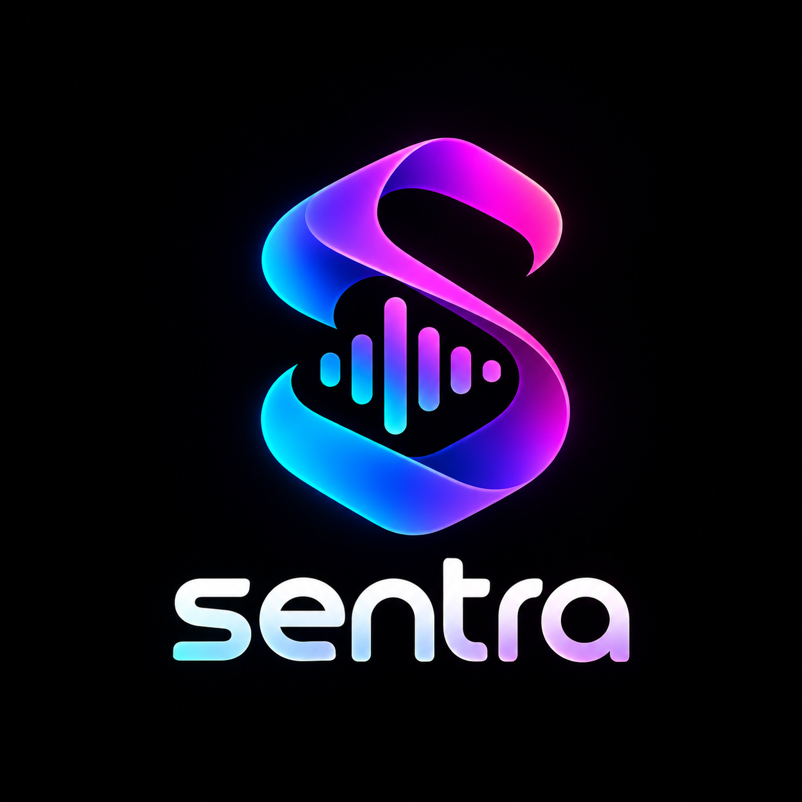
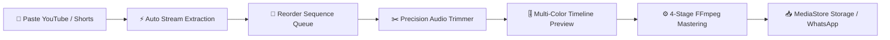

<p align="center">
  
</p>

<h1 align="center">⚡ SENTRA</h1>

<p align="center">
  <strong>Seamless YouTube Song Sequencer, Precision Audio Trimmer & Studio Mix Master</strong>
</p>

<p align="center">
  <a href="LICENSE"></a>
  <a href="https://flutter.dev"></a>
  <a href="https://dart.dev"></a>
  
  <a href="https://github.com/rutwikhere/Sentra/stargazers"></a>
</p>

<p align="center">
  <a href="#-about-sentra">About</a> •
  <a href="#-core-workflow">Workflow</a> •
  <a href="#-key-features">Features</a> •
  <a href="#-design-system--theme">Design System</a> •
  <a href="#-architecture">Architecture</a> •
  <a href="#-getting-started">Getting Started</a> •
  <a href="#-license">License</a>
</p>

---

## 🎧 About Sentra

**Sentra** is an open-source, studio-grade audio sequencing and trimming workstation crafted in Flutter. Designed with a clean, high-contrast white aesthetic powered by electric-blue and vivid-violet accents, Sentra transforms YouTube videos and Shorts into high-fidelity music mixes. 

Paste links, customize track sequences, isolate your favorite clips with millisecond-accurate trimming tools, preview transitions on an interactive multi-colored timeline, and master into studio-quality **MP3** audio or **MP4** music videos saved directly into your device's native media storage.

---

## 🔄 Core Workflow



1. **Input**: Paste standard YouTube URLs or YouTube Shorts (`shorts/`, `youtu.be`, `watch?v=`).
2. **Extract**: Stream extraction immediately caches high-bitrate audio and metadata.
3. **Sequence**: Arrange the playback sequence using smooth drag-and-drop handles.
4. **Trim**: Set isolated start and end boundaries with live scrubber playback and `mm:ss` manual time inputs.
5. **Timeline**: Preview your combined mix using the interactive multi-color timeline slider.
6. **Master**: 4-stage automated FFmpeg pipeline executes precision trimming, crossfading, normalization, and stitching.
7. **Export**: Direct native storage export to Android `Music/Sentra` or one-tap WhatsApp and system sharing.

---

## ✨ Key Features

### 🔗 Universal Stream Extraction
- Supports YouTube standard videos, mobile URLs, shortlinks (`youtu.be`), and YouTube Shorts.
- Automatic background caching with animated progress indicators and live status badges.
- Automatic retrieval of video titles, channel artists, duration, and high-resolution thumbnail artwork.

### ✂️ Precision Trimming Studio
- **Independent Trimming Popups**: Dedicated workspace for each song with custom entrance scale animations.
- **Dual Input Modes**: Interactive slider scrubber with millisecond precision plus manual `mm:ss` timestamp text inputs.
- **Trim-Isolated Playback**: In-app preview player locked to the chosen clip boundaries.

### 🎚️ Master Mix Timeline Player
- **Dynamic Multi-Song Color Bands**: Each song in the mix is assigned a distinct color in the playback track matching its sequence badge.
- **Player Placement**: Responsive play/pause button situated on the left of the timeline slider.
- **Real-Time Duration Counter**: Live updating `${current_pos} / ${total_mix_duration}` timer indicator.

### ⚙️ Studio Audio Pipeline
- **FFmpeg Kit Integration**: High-fidelity audio concatenation and volume normalization.
- **4-Stage Visual Progress**: Real-time pipeline status tracking (*Downloading high-bitrate stream* $\to$ *Precision trimming* $\to$ *Crossfade stitching* $\to$ *Final export*).
- **Master Quality**: Configurable high-bitrate output (192 kbps / 320 kbps studio master).

### 📲 Native Android Downloads & Instant Sharing
- **Native MediaStore Integration**: Exports directly to the device's public `Music/Sentra` or `Download` directories with native Android media scanner indexing.
- **One-Tap WhatsApp Share**: Direct intent routing to WhatsApp chats and WhatsApp Status.
- **Universal System Share**: Share mixes via Telegram, Discord, Drive, Email, or Bluetooth via `share_plus`.
- **Music Video Generator**: Synthesizes an MP4 video with official Sentra visual artwork for social sharing.

---

## 🎨 Design System & Theme

Sentra features a tailored **Pure White & Electric Blue** visual identity built for clarity, tactile responsiveness, and fluid motion:

| Accent | Color Code | Role |
| :--- | :--- | :--- |
| **Electric Blue** | `#3867FF` | Primary brand accent, progress rings, CTA buttons |
| **Vivid Violet** | `#853CFF` | Secondary gradient accent & share actions |
| **Emerald Green** | `#10B981` | Success states, downloaded indicators & ready badges |
| **Clean Background**| `#FFFFFF` | Main application canvas & cards |
| **Secondary Canvas**| `#F4F7FB` | Input containers, headers & subtle elevation |
| **Slate Charcoal** | `#0D1117` | High-contrast typography & headings |

* **Micro-Interactions**: Fluid `AnimatedSwitcher` transitions for buttons, loading indicators, and playback controls.
* **Shared-Axis Motion**: Material 3 `ZoomPageTransitionsBuilder` for smooth screen switching.
* **Breathing Ambient Glow**: Glowing pulse animations on hero brand elements.

---

## 🏗️ Architecture

```
lib/
├── main.dart                       # App entry point & AppTheme configuration
├── models/
│   ├── track_item.dart             # Track metadata, trim boundaries & download states
│   └── song_slot.dart              # Slot allocation models
├── screens/
│   ├── welcome_screen.dart         # Hero landing screen with breathing logo & entrance animations
│   ├── song_input_screen.dart      # Queue manager with clipboard paste & background downloads
│   ├── main_editing_screen.dart    # Sequence reorder, trim dialog & master multi-color timeline
│   └── download_export_screen.dart # 4-stage mastering pipeline, native export & video generator
├── services/
│   ├── audio_merge_service.dart    # FFmpeg trimming, concatenation & duration formatting
│   ├── youtube_service.dart        # YouTubeExplode stream extraction & Shorts parsing
│   └── share_service.dart          # Native share sheet & WhatsApp direct intents
├── theme/
│   └── app_theme.dart              # Custom design tokens, palettes & page transitions
└── widgets/
    ├── timeline_slider_shapes.dart # Multi-color track shape & custom slider thumb
    ├── track_card.dart             # Song list item with progress & badge indicators
    └── trim_editor.dart            # Dual-range slider editor components
```

---

## 🚀 Getting Started

### Prerequisites
- [Flutter SDK](https://docs.flutter.dev/get-started/install) (`v3.24+` recommended)
- Android Studio / VS Code with Dart & Flutter plugins
- Physical Android device or Windows Desktop environment

### Installation

1. **Clone the repository:**
   ```bash
   git clone https://github.com/rutwikhere/Sentra.git
   cd Sentra
   ```

2. **Fetch dependencies:**
   ```bash
   flutter pub get
   ```

3. **Verify analyzer & test suite:**
   ```bash
   flutter analyze
   flutter test
   ```

4. **Run on connected device:**
   ```bash
   # Run on Android
   flutter run -d android

   # Run on Windows Desktop
   flutter run -d windows
   ```

5. **Build Release APK:**
   ```bash
   flutter build apk --release
   ```
   *The generated APK will be located at `build/app/outputs/flutter-apk/app-release.apk`.*

---

## 🧪 Testing

Sentra includes comprehensive unit and widget tests:
```bash
flutter test
```
- **Timecode parsing & formatting**: Validation of `mm:ss` and `hh:mm:ss` boundary cases.
- **Duration math**: Verification of accumulated duration & active track indexing.
- **YouTube URL Regex**: Comprehensive test coverage for desktop, mobile, shorts, and tracking query links.
- **UI Smoke Tests**: Verification of widget trees and theme initializations.

---

## 🤝 Contributing

Contributions are welcome! If you'd like to improve Sentra:
1. Fork the Project
2. Create your Feature Branch (`git checkout -b feature/AmazingFeature`)
3. Commit your Changes (`git commit -m 'Add some AmazingFeature'`)
4. Push to the Branch (`git push origin feature/AmazingFeature`)
5. Open a Pull Request

---

## 📄 License

Distributed under the **MIT License**. See [`LICENSE`](LICENSE) for more information.

<p align="center">
  Crafted with ❤️ by <a href="https://github.com/rutwikhere">Rutwik</a>
</p>
